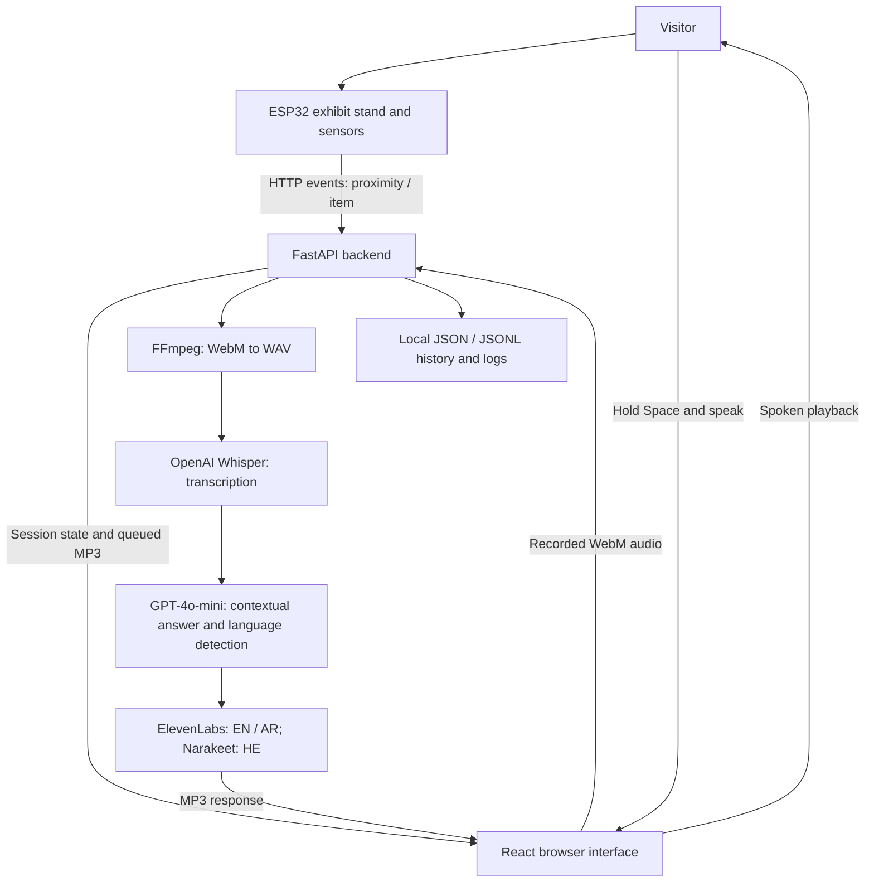

# Musea — AI Museum Guide

**An accessible, multilingual museum experience powered by tangible interaction, speech, and conversational AI.**

Musea is a research prototype designed to make museum exhibits more accessible to blind and visually impaired visitors while remaining usable by a wider audience. Visitors can explore artifacts through physical interactions, listen to curated audio descriptions, and—on supported exhibits—ask spoken questions about an artifact and its historical context.

The system combines an **ESP32-based interactive exhibit stand**, a **React web interface**, and a **Python FastAPI backend** with speech recognition, AI-generated answers, and text-to-speech.

> **Project status:** Research prototype for a single exhibit stand. This README documents the **FastAPI / HTTP-event Musea implementation**. A separate React + ESP32 WebSocket demonstration in the supplied files uses direct `HOME` navigation messages and is **not** the same integration. Do not assume that demo firmware is compatible with the endpoints below without adapting it.

## Contents

- [Key features](#key-features)
- [Visitor experience](#visitor-experience)
- [System architecture](#system-architecture)
- [Supported exhibits](#supported-exhibits)
- [Technology stack](#technology-stack)
- [Repository structure](#repository-structure)
- [Prerequisites](#prerequisites)
- [Local setup](#local-setup)
- [Running a demo without hardware](#running-a-demo-without-hardware)
- [API overview](#api-overview)
- [Development and configuration](#development-and-configuration)
- [Accessibility and research considerations](#accessibility-and-research-considerations)
- [Known limitations](#known-limitations)
- [Troubleshooting](#troubleshooting)

## Key features

- **Audio-first interaction:** Introductions and responses are delivered through sound rather than relying on visual text.
- **Tangible exhibit selection:** The stand reports visitor proximity, item pickup, item return, and multiple-item interactions.
- **Multilingual questions and answers:** English, Arabic, and Hebrew.
- **Two content modes:** Curated, prerecorded explanations and contextual AI question-answering.
- **Press-and-hold recording:** Ask a question by holding **Space** in the browser (or a compatible hardware input) and releasing to submit.
- **Audio queue and feedback:** Queued recordings, recording cues, a waiting clip, and replay controls in the browser.
- **Research logging:** Local conversation history and timestamped interaction/pipeline logs, including speech-processing timings.

## Visitor experience

1. **Approach:** A proximity event signals that someone has approached the stand, and a welcome recording is queued.
2. **Explore:** Lifting an exhibit selects its content and triggers an introductory explanation.
3. **Listen or ask:** For prerecorded exhibits, pressing Space advances through available clips. For AI-enabled exhibits, holding Space records a question; releasing it submits the recording.
4. **Receive an answer:** The backend processes the question and returns synthesized speech in the detected language.
5. **Return:** Returning an item clears its selection and resets its recorded-clip sequence.

## System architecture



**Two paths operate together:**

- **Exhibit-event path:** ESP32 → `POST /esp-event` → backend state/audio queue → browser polling → playback.
- **Conversational path:** Browser recording → `POST /post-audio` → FFmpeg → Whisper → GPT-4o-mini → speech synthesis → browser playback.

The browser currently **polls** for session state and queued audio; the documented implementation does not require a WebSocket server for this path.

## Supported exhibits

The backend API uses **zero-based indexes**, while the interface numbers exhibits from 1.

| Display number | API index | Exhibit | Current interaction |
| --- | ---: | --- | --- |
| 1 | `0` | Kohl Vessel | Prerecorded introduction + AI voice Q&A |
| 2 | `1` | Recorded exhibit | Three prerecorded clips, advanced with Space |
| 3 | `2` | Recorded exhibit | Three prerecorded clips, advanced with Space |
| 4 | `3` | Nike Figurine | Prerecorded introduction + AI voice Q&A |

> Exhibits 2 and 3 have placeholder descriptions in the documented source. AI-chat requests for those indexes return HTTP `204`; they are intended to use the prerecorded-clip workflow.

## Technology stack

| Layer | Technology | Role |
| --- | --- | --- |
| Hardware | ESP32 + exhibit sensors | Detect proximity and object interaction |
| Frontend | React + Vite | Recording, audio playback, visitor controls |
| Backend | Python + FastAPI | Events, session state, audio queue, request orchestration |
| Audio conversion | FFmpeg | Convert recorded WebM to WAV |
| Speech-to-text | OpenAI Whisper (`whisper-1`) | Transcribe visitors' questions |
| AI and language detection | OpenAI `gpt-4o-mini` | Generate exhibit-contextual answers and identify language |
| Text-to-speech | ElevenLabs | English and Arabic speech |
| Text-to-speech | Narakeet | Hebrew speech |
| Data | JSON and JSONL | Conversation history and interaction logs |

## Repository structure

The documented FastAPI-based implementation is organized as follows:

```text
backEnd/
├── main.py                       # FastAPI app, exhibit state, and event endpoints
├── requirements.txt              # Python dependency snapshot
├── mock_esp32.py                 # Legacy simulator (protocol update required)
├── functions/
│   ├── database.py               # Exhibit contexts, prompts, history, logging
│   ├── openAI_requests.py        # Transcription and AI answers
│   ├── lang_detect.py            # English / Arabic / Hebrew identification
│   └── text_to_speach.py         # ElevenLabs and Narakeet TTS
└── *.mp3                         # Recordings loaded by the active backend

frontEnd/
└── vite-project/
    ├── package.json              # Frontend scripts and dependencies
    ├── src/
    │   ├── App.tsx               # Loads active interface
    │   └── componants/
    │       └── SimpleApp.tsx     # Visitor controls, recording, playback
    └── public/                   # Click / waiting sounds
```

Directory and file spellings above reflect the documented source, including `componants` and `text_to_speach.py`.

## Prerequisites

- **Python:** 3.11 or 3.12 is a reasonable starting point for the recorded dependency snapshot (no Python version is formally declared).
- **Node.js and npm:** A version compatible with Vite 7, such as Node.js 20.19+ or 22.12+.
- **FFmpeg:** Installed and accessible from your terminal via `ffmpeg`.
- **Browser:** Chrome or Edge with WebM recording and microphone support.
- **Audio hardware:** Microphone plus speakers or headphones.
- **Internet connectivity:** Required for cloud-based transcription, AI generation, and text-to-speech.
- **Provider credentials:** OpenAI, ElevenLabs, and Narakeet credentials with the necessary access.

> The captured Python requirements include Windows-specific dependencies. The setup steps below target **Windows PowerShell**; installation on other systems may require dependency adjustments.

## Local setup

Run the following from the **repository root** unless stated otherwise.

### 1. Set up the backend

```powershell
cd backEnd
python -m venv .venv
.\.venv\Scripts\Activate.ps1
python -m pip install --upgrade pip
python -m pip install -r requirements.txt
ffmpeg -version
```

Create a `backEnd/.env` file with your own credentials:

```dotenv
OPENAI_API_KEY=your_openai_api_key
OPENAI_ORG=your_openai_organization_id
ELEVENLABS_API_KEY=your_elevenlabs_api_key
NARAKEET_API_KEY=your_narakeet_api_key
```

The documented implementation reads all four environment-variable names during import, including `OPENAI_ORG`.

**Never commit real API keys, `.env` files, visitor recordings, or identifiable research logs to version control.**

From **inside `backEnd`**, start the API:

```powershell
python -m uvicorn main:app --reload --host 0.0.0.0 --port 8000
```

- API: <http://localhost:8000>
- Interactive API documentation: <http://localhost:8000/docs>

Running from the backend directory matters because the documented code uses relative paths for audio and stored data.

### 2. Start the frontend

In a **second terminal**, starting at the repository root:

```powershell
cd frontEnd/vite-project
npm install
npm run dev
```

Open the address shown by Vite, normally <http://localhost:5173>. Grant microphone permission and interact with the page if browser autoplay restrictions prevent audio from starting automatically.

**Backend URL:** The documented `src/componants/SimpleApp.tsx` currently sets `BACKEND_URL` to `http://localhost:8000`. If the interface runs on a separate tablet or computer, configure it to use an address reachable from that device and adjust the backend's CORS origins accordingly. Microphone access from a non-localhost web origin generally requires HTTPS.

### 3. Connect the ESP32 stand (optional)

The ESP32 firmware for this **HTTP-event implementation** is not included in the documented repository. A compatible device must send the event payloads described in the [API overview](#api-overview) to the backend's reachable address.

A separate ESP32 WebSocket button demonstration that sends `HOME` to a React application is a different protocol; it does not replace the Musea HTTP-event integration.

## Running a demo without hardware

You can test the event-to-audio flow with the backend and frontend running. Keep the browser open so it can receive queued recordings.

### Simulate a visitor approaching

```powershell
Invoke-RestMethod -Method Post `
  -Uri 'http://localhost:8000/esp-event' `
  -ContentType 'application/json' `
  -Body '{"event_type":"proximity"}' `
  -OutFile "$env:TEMP\musea-intro.mp3"
```

### Select the Kohl Vessel

```powershell
Invoke-RestMethod -Method Post `
  -Uri 'http://localhost:8000/esp-event' `
  -ContentType 'application/json' `
  -Body '{"event_type":"item","item_index":0}' `
  -OutFile "$env:TEMP\musea-item.mp3"
```

Now **hold Space**, ask a question, and release Space to submit it.

### Return the item

```powershell
Invoke-RestMethod -Method Post `
  -Uri 'http://localhost:8000/esp-event' `
  -ContentType 'application/json' `
  -Body '{"event_type":"item","item_index":-1}'
```

Try `item_index` values `1`, `2`, and `3` for the other exhibits. To simulate a multiple-item interaction, send:

```json
{"event_type":"item","multi":true}
```

> `mock_esp32.py` follows an older protocol (`lift_state`, `gone`, and recording events). Update it to the current request shapes before using it as a simulator.

## API overview

| Method | Route | Purpose |
| --- | --- | --- |
| `POST` | `/esp-event` | Receive proximity / item events and queue audio |
| `GET` | `/session-state` | Return whether the session is active and the zero-based selected item index |
| `GET` | `/get-latest-esp-audio` | Return the next queued MP3 or `{"status":"no_event"}` |
| `POST` | `/post-audio` | Accept a multipart `file` recording and return a spoken AI answer |
| `POST` | `/cycle-next` | Queue / return the next clip for a prerecorded exhibit |
| `GET` | `/reset` | Clear saved conversation messages |
| `GET` | `/Status_of_women` | Return a static status message |

**Important:** `/reset` clears the stored conversation history, not the entire hardware or exhibit session. The current backend does not implement a `gone` event.

For interactive endpoint details, visit <http://localhost:8000/docs> after starting the backend.

## Development and configuration

From `frontEnd/vite-project`:

```powershell
npm run build       # Type-check and build the production frontend into dist/
npm run lint        # Run ESLint
npm run preview     # Preview the built frontend locally
```

Relevant backend configuration:

- **Artifact descriptions, prompts, and logging:** `backEnd/functions/database.py`
- **Recorded-clip mappings and event behavior:** `backEnd/main.py`
- **Speech models and voices:** `backEnd/functions/text_to_speach.py`

Some source files retain older implementations in comments or triple-quoted strings. For the documented application, the active React interface is `SimpleApp.tsx`, and the active backend implementation appears at the end of `main.py`.

## Accessibility and research considerations

Musea is designed around **audio-first and tactile interaction**: visitors can approach, handle an exhibit, and listen without first finding a menu or reading a visual label. Both curated narration and conversational exploration can be studied to understand how visitors engage with museum content.

For structured accessibility evaluation, consider assessing clarity of audio instructions, discoverability of physical controls, speech-recognition failures across supported languages, response latency, error recovery, visitor autonomy, and user control over interruptions and replay.

**Privacy:** The prototype records conversational and interaction data. Obtain informed consent where research requires it; minimize personal information; protect logs; define a retention/deletion policy; and restrict access to recordings and transcripts. Logging alone does not establish that privacy or accessibility requirements have been satisfied.

## Known limitations

- **Single-stand architecture:** Session state and queued audio are shared in memory; use one backend worker and one demo client.
- **Cloud dependency:** Conversational AI requires reachable external services and valid credentials.
- **Two exhibit modes:** Items 2 and 3 use prerecorded clips rather than AI Q&A; their descriptive content is currently placeholder text.
- **Local file paths:** The active backend reads MP3s from its working directory; recordings organized under language folders are not automatically selected.
- **Filename case:** The welcome handler expects `intro.mp3`, while the documented root recording is `Intro.mp3`. Match the filename/capitalization on case-sensitive systems.
- **Legacy simulator:** `mock_esp32.py` does not speak the current event protocol without modification.
- **Testing:** Frontend build/lint scripts exist, but a dedicated automated test suite is not documented.
- **Deployment:** This is a research prototype, not a hardened multi-visitor public deployment.

## Troubleshooting

| Problem | What to check |
| --- | --- |
| Backend does not start | Check the four `.env` variable names, dependencies, and terminal errors. |
| WebM-to-WAV conversion fails | Run `ffmpeg -version` in the backend terminal. |
| Audio file returns 404 | Start the backend from `backEnd`; verify MP3 filename and capitalization. |
| No AI answer for exhibit 2 or 3 | These exhibits intentionally use recorded clips; press Space to advance. |
| Microphone does not work | Enable browser microphone permission; use localhost or an HTTPS origin. |
| Browser does not play audio | Interact with the page, check autoplay restrictions, and verify `BACKEND_URL`. |
| AI or synthesized speech fails | Inspect backend logs, API credentials, provider access, and available usage. |
| Stand events do not appear | Check the ESP32 destination IP/network and the shape of the JSON event payload. |
| Works on the computer, not on a tablet | `localhost` on the tablet is not the backend computer; use a reachable backend address and configure CORS/HTTPS. |

---

**Musea** explores how **physical interaction, accessible audio, and conversational AI** can support more inclusive ways of experiencing cultural heritage.
